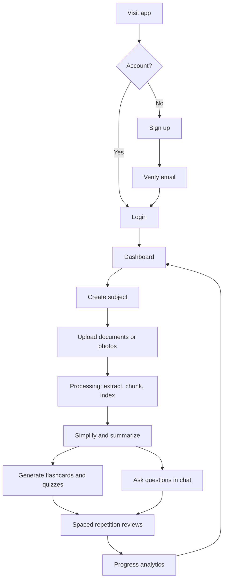
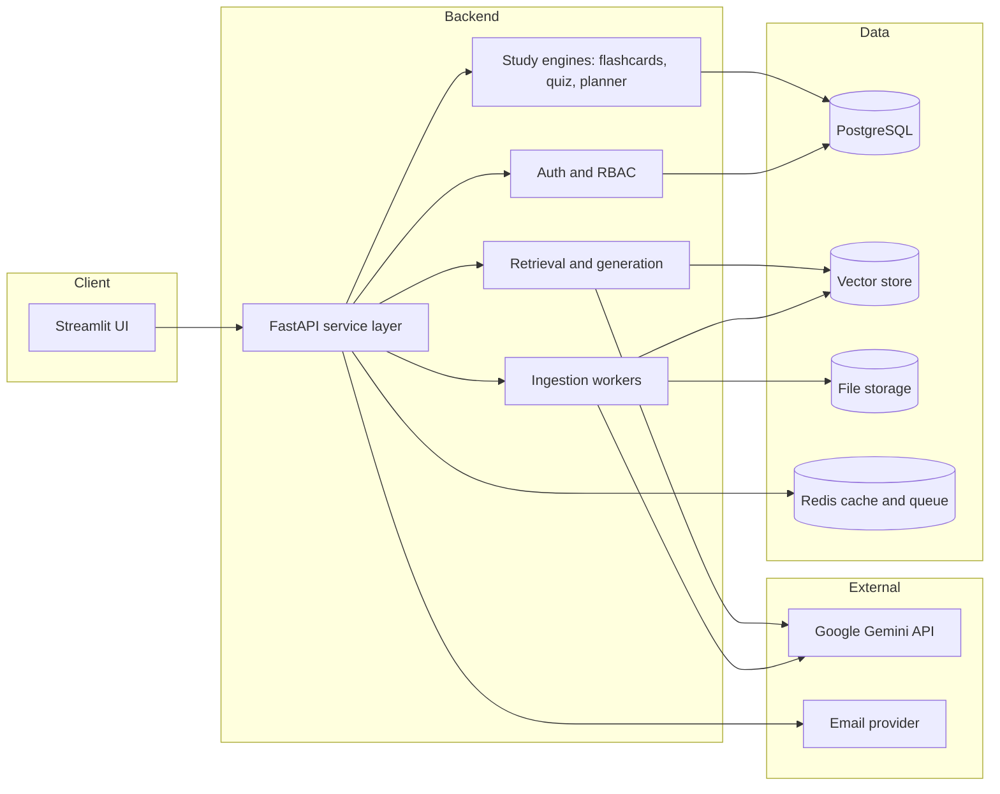
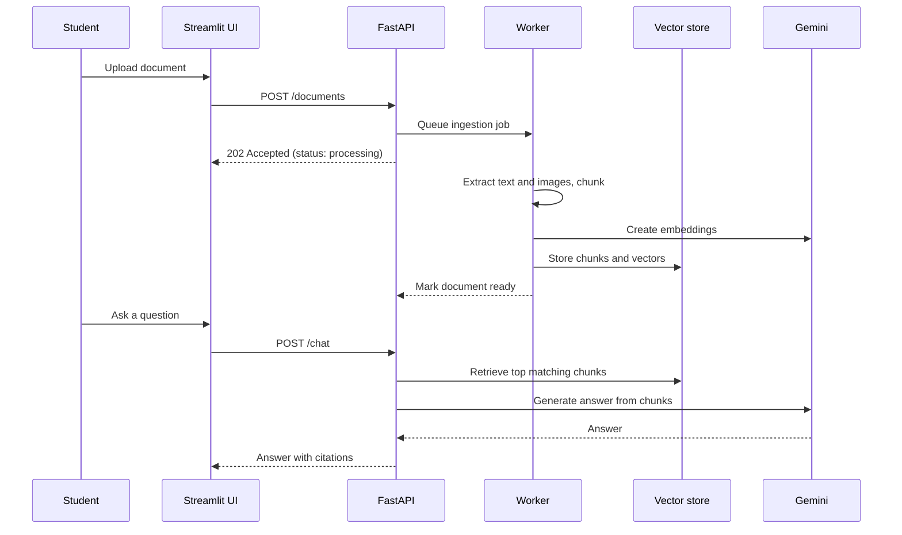
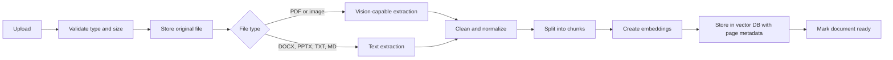
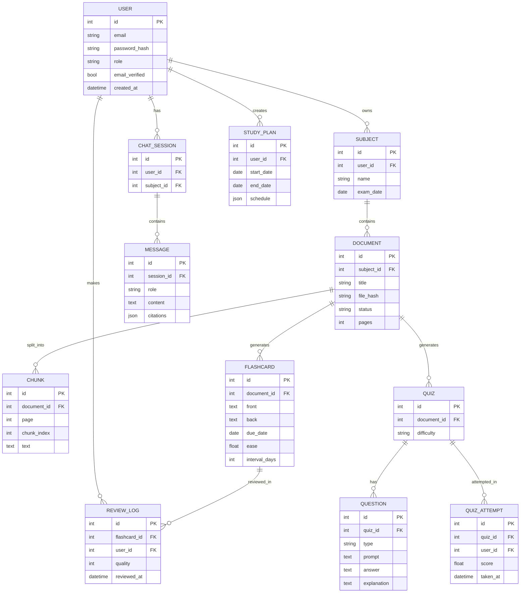

<div align="center">


# 📚 Snap & Study

### The AI study platform: snap your notes, simplify them, master them.

Upload notes, textbooks, slides, or photos of handwritten pages. Snap & Study turns them into simple explanations, summaries, mind maps, flashcards, quizzes, and a chat that answers questions **with citations from your own material**, all behind secure, role-based access.


[Live Demo](#) · [Documentation](docs/) · [Report a Bug](#) · [Request a Feature](#) · [Ask a Doubt](#) · [Changelog](CHANGELOG.md)

</div>

---

## 📑 Table of Contents

1. [Vision and Problem Statement](#-vision-and-problem-statement)
2. [Feature Overview](#-feature-overview)
3. [User Roles](#-user-roles)
4. [User Journey](#-user-journey)
5. [System Architecture](#-system-architecture)
6. [Tech Stack](#-tech-stack)
7. [Project Structure](#-project-structure)
8. [Prerequisites](#-prerequisites)
9. [Quick Start](#-quick-start)
10. [Configuration Reference](#-configuration-reference)
11. [Authentication and Login](#-authentication-and-login)
12. [Document Ingestion Pipeline](#-document-ingestion-pipeline)
13. [Study Modules](#-study-modules)
14. [Q&A Chat with Citations (RAG)](#-qa-chat-with-citations-rag)
15. [Database Design](#-database-design)
16. [REST API](#-rest-api)
17. [Prompt Engineering](#-prompt-engineering)
18. [UI and UX Guidelines](#-ui-and-ux-guidelines)
19. [Testing Strategy](#-testing-strategy)
20. [Docker and Deployment](#-docker-and-deployment)
21. [CI/CD](#-cicd)
22. [Security and Privacy](#-security-and-privacy)
23. [Performance and Cost Control](#-performance-and-cost-control)
24. [Observability](#-observability)
25. [Accessibility and Internationalization](#-accessibility-and-internationalization)
26. [Troubleshooting](#-troubleshooting)
27. [FAQ](#-faq)
28. [Roadmap and Milestones](#-roadmap-and-milestones)
29. [Team and Workflow](#-team-and-workflow)
30. [Contributing](#-contributing)
31. [Code of Conduct](#-code-of-conduct)
32. [License](#-license)
33. [Acknowledgements](#-acknowledgements)

> **Status legend used in this document:** ✅ Implemented · 🚧 In progress · 🗓 Planned. Update these as the project moves forward.

---

## 🎯 Vision and Problem Statement

Students collect large amounts of study material (lecture notes, PDFs, slide decks, textbook photos), but turning that pile into real understanding takes hours of rereading, summarizing, and self-testing.

**Snap & Study** aims to be a single place where a student can:

1. **Capture** material in any format, including a quick phone photo of a page.
2. **Understand** it through simplified explanations at the right level.
3. **Retain** it through flashcards, quizzes, and spaced repetition.
4. **Ask** questions and get answers grounded in their own documents, with sources.
5. **Track** progress and stay consistent with a study planner and analytics.

**Goals**

- Cut the time from "raw notes" to "ready to revise" from hours to minutes.
- Keep every AI answer traceable to the student's own material.
- Provide a secure, professional experience suitable for schools, colleges, and self-learners.

**Non-goals (for now)**

- Replacing teachers or textbooks.
- Training custom AI models. The project uses hosted models through APIs.

---

## ✨ Feature Overview

### Core

| Feature | Description | Status |
|---|---|---|
| 🔐 Professional login | Email/password sign-in, sign-up, password reset, session handling | 🚧 |
| 🌐 Social login | Google sign-in via OpenID Connect | 🗓 |
| 👥 Role-based access | Student, Teacher, Admin roles | 🗓 |
| 🗂 Subjects and workspaces | Organize documents by subject, course, or exam | 🗓 |
| 📤 Multi-format upload | PDF, DOCX, PPTX, TXT, MD, JPG, JPEG, PNG | 🚧 |
| ✍️ Handwriting and photo reading | Vision-based reading of photographed notes | 🚧 |
| 🧠 Simplify | Rewrite content at Beginner, Intermediate, or Exam-ready level | 🚧 |
| 📝 Smart summaries | Short, structured study notes with key terms | 🚧 |
| 💬 Q&A chat | Conversational answers with citations to source pages | 🚧 |

### Learning tools

| Feature | Description | Status |
|---|---|---|
| 🃏 Flashcards | Auto-generated cards with spaced repetition (SM-2) | 🗓 |
| ❓ Quizzes | MCQ, true/false, and short-answer, with explanations | 🗓 |
| 🕸 Mind maps | Visual concept maps generated from a document | 🗓 |
| 📅 Study planner | Exam date based schedule with daily goals | 🗓 |
| 📈 Progress analytics | Streaks, quiz scores, weak topics, time studied | 🗓 |
| 🔎 Semantic search | Search across all your documents by meaning | 🗓 |

### Platform

| Feature | Description | Status |
|---|---|---|
| 📥 Export | Download notes and flashcards as PDF, DOCX, or Markdown | 🗓 |
| 🌍 Multi-language | Explanations and UI in multiple languages | 🗓 |
| 👩‍🏫 Teacher tools | Share material to a class, view class-level analytics | 🗓 |
| 🛠 Admin console | Manage users, usage limits, and content reports | 🗓 |
| 🔔 Notifications | Email reminders, optional WhatsApp summaries | 🗓 |
| 🧾 Audit logs | Track sensitive actions for accountability | 🗓 |
| 🔌 REST API | Programmatic access for integrations | 🗓 |

---

## 👥 User Roles

| Role | Can do |
|---|---|
| **Student** | Upload documents, use all study modules, chat, manage their own data |
| **Teacher** | Everything a student can, plus create classes, share material, and view class analytics |
| **Admin** | Manage users and roles, set usage quotas, review reports, view system health |

Permissions are enforced on the backend, not just hidden in the UI.

---

## 🧭 User Journey



---

## 🏗 System Architecture



**Design principles**

- **Layered:** UI never talks to the database or AI directly. Everything goes through the service layer.
- **Stateless UI, stateful backend:** Streamlit holds only session state; data lives in the database.
- **Async where it matters:** Heavy work (extraction, embedding) runs in background workers.
- **Swappable parts:** Vector store, model provider, and storage are behind interfaces.

### Upload to answer sequence



---

## 🛠 Tech Stack

| Layer | Technology | Purpose |
|---|---|---|
| Language | Python 3.10+ | Entire codebase |
| Frontend | Streamlit | Multi-page UI |
| Backend API | FastAPI + Uvicorn | Service layer and REST API |
| AI | Google Gemini via `google-genai` | Chat, vision, embeddings, generation |
| Database | PostgreSQL (SQLite for local dev) | Users, documents, study data |
| ORM and migrations | SQLAlchemy + Alembic | Models and schema versions |
| Vector store | ChromaDB (or pgvector) | Semantic search and retrieval |
| Cache and queue | Redis + RQ (or Celery) | Background jobs, rate limiting |
| Document parsing | `pypdf`, `python-docx`, `python-pptx` | Text extraction |
| Auth | Password hashing with `argon2-cffi`, JWT sessions, optional OIDC | Secure sign-in |
| Validation | Pydantic | Request and config validation |
| Testing | pytest, pytest-cov, Playwright | Unit, integration, end-to-end |
| Quality | Ruff, Black, mypy, pre-commit | Linting, formatting, types |
| Containers | Docker, Docker Compose | Reproducible environments |
| CI/CD | GitHub Actions | Test, build, deploy |

> The stack is a recommended target. Streamlit and Gemini are the core; the rest can be adopted in phases (see the [Roadmap](#-roadmap-and-milestones)).

---

## 📁 Project Structure

```
snap-and-study/
├── README.md
├── CHANGELOG.md
├── CONTRIBUTING.md
├── CODE_OF_CONDUCT.md
├── LICENSE
├── pyproject.toml                  # Tooling config (ruff, black, mypy, pytest)
├── requirements.txt                # Runtime dependencies
├── requirements-dev.txt            # Dev and test dependencies
├── Dockerfile
├── docker-compose.yml
├── .env.example                    # Template for environment variables
├── .gitignore
├── .pre-commit-config.yaml
│
├── app/                            # Streamlit frontend
│   ├── Home.py                     # Entry point and routing
│   ├── pages/
│   │   ├── 1_Dashboard.py
│   │   ├── 2_Library.py            # Subjects and documents
│   │   ├── 3_Study_Notes.py        # Simplify and summaries
│   │   ├── 4_Chat.py               # Q&A with citations
│   │   ├── 5_Flashcards.py
│   │   ├── 6_Quizzes.py
│   │   ├── 7_Planner.py
│   │   ├── 8_Analytics.py
│   │   └── 9_Admin.py
│   ├── components/                 # Reusable UI parts (cards, uploader, charts)
│   ├── auth_ui.py                  # Login, sign-up, reset screens
│   └── styles.py                   # Theme and CSS helpers
│
├── backend/                        # Service layer and API
│   ├── main.py                     # FastAPI app
│   ├── config.py                   # Settings loaded from environment
│   ├── deps.py                     # Dependency injection (db session, current user)
│   ├── routers/
│   │   ├── auth.py
│   │   ├── users.py
│   │   ├── subjects.py
│   │   ├── documents.py
│   │   ├── chat.py
│   │   ├── flashcards.py
│   │   ├── quizzes.py
│   │   ├── planner.py
│   │   ├── analytics.py
│   │   └── admin.py
│   ├── services/
│   │   ├── auth_service.py
│   │   ├── ingestion_service.py
│   │   ├── llm_service.py          # Gemini wrapper (chat, vision, embeddings)
│   │   ├── retrieval_service.py    # Chunk search and ranking
│   │   ├── flashcard_service.py    # SM-2 scheduling
│   │   ├── quiz_service.py
│   │   ├── planner_service.py
│   │   └── export_service.py
│   ├── models/                     # SQLAlchemy models
│   ├── schemas/                    # Pydantic schemas
│   ├── workers/                    # Background jobs
│   ├── prompts/                    # Prompt templates (one file per task)
│   │   ├── system.py
│   │   ├── simplify.py
│   │   ├── summarize.py
│   │   ├── flashcards.py
│   │   ├── quiz.py
│   │   └── chat.py
│   └── utils/                      # Chunking, hashing, file helpers, logging
│
├── migrations/                     # Alembic migrations
├── tests/
│   ├── unit/
│   ├── integration/
│   └── e2e/
├── docs/                           # Extra documentation, diagrams, screenshots
├── assets/                         # Logo and images
├── scripts/                        # Seed data, maintenance, one-off tools
├── .streamlit/
│   ├── config.toml                 # Theme
│   └── secrets.toml.example
└── .github/
    ├── workflows/ci.yml
    ├── ISSUE_TEMPLATE/
    └── PULL_REQUEST_TEMPLATE.md
```

---

## ✅ Prerequisites

- **Python 3.10 or newer**
- Basic comfort with Python (the main prerequisite for students following the workshop)
- A **Google AI Studio** account for a Gemini API key
- **Docker and Docker Compose** (recommended, for PostgreSQL and Redis)
- **Git** and a **GitHub** account
- Optional: an SMTP or email API account for verification and reset emails

---

## 🚀 Quick Start

### Option A: Docker (recommended)

```bash
git clone https://github.com/<your-username>/snap-and-study.git
cd snap-and-study
cp .env.example .env          # then fill in your values
docker compose up --build
```

| Service | URL |
|---|---|
| Streamlit app | http://localhost:8501 |
| FastAPI docs | http://localhost:8000/docs |

### Option B: Local without Docker (simple mode)

Uses SQLite and an embedded vector store, with no Redis or PostgreSQL.

```bash
git clone https://github.com/<your-username>/snap-and-study.git
cd snap-and-study

python -m venv venv
# macOS/Linux:        source venv/bin/activate
# Windows PowerShell: .\venv\Scripts\Activate.ps1
# Windows cmd.exe:    venv\Scripts\activate.bat

pip install -r requirements.txt
cp .env.example .env          # set GEMINI_API_KEY and SECRET_KEY

alembic upgrade head          # create database tables
uvicorn backend.main:app --reload --port 8000     # terminal 1
streamlit run app/Home.py                         # terminal 2
```

> If PowerShell blocks the activation script, run `Set-ExecutionPolicy -Scope Process -ExecutionPolicy Bypass` first.

### Create the first admin user

```bash
python scripts/create_admin.py --email admin@example.com
```

---

## ⚙️ Configuration Reference

Copy `.env.example` to `.env` and fill in the values. **Never commit `.env`.**

```dotenv
# --- App ---
APP_ENV=development                # development | staging | production
SECRET_KEY=change-me-to-a-long-random-string
ACCESS_TOKEN_EXPIRE_MINUTES=60

# --- AI ---
GEMINI_API_KEY=your-gemini-api-key
GEMINI_CHAT_MODEL=<model-name>     # check current names in Google AI Studio
GEMINI_EMBEDDING_MODEL=<model-name>

# --- Database ---
DATABASE_URL=sqlite:///./snapstudy.db
# DATABASE_URL=postgresql+psycopg://user:pass@db:5432/snapstudy

# --- Cache and queue ---
REDIS_URL=redis://redis:6379/0

# --- Storage ---
UPLOAD_DIR=./storage/uploads
MAX_UPLOAD_MB=25

# --- Limits ---
DAILY_AI_REQUESTS_PER_USER=200
RATE_LIMIT_PER_MINUTE=30

# --- Email (optional) ---
SMTP_HOST=
SMTP_PORT=587
SMTP_USER=
SMTP_PASSWORD=
EMAIL_FROM=no-reply@snapandstudy.example

# --- OAuth (optional) ---
GOOGLE_CLIENT_ID=
GOOGLE_CLIENT_SECRET=
```

| Variable | Required | Notes |
|---|---|---|
| `SECRET_KEY` | Yes | Used to sign tokens. Generate with `python -c "import secrets; print(secrets.token_urlsafe(48))"` |
| `GEMINI_API_KEY` | Yes | From Google AI Studio |
| `DATABASE_URL` | Yes | SQLite for dev, PostgreSQL for production |
| `REDIS_URL` | Production | Needed for background jobs and rate limiting |
| `SMTP_*` | Optional | Enables email verification and password reset |

---

## 🔐 Authentication and Login

The login experience is the first impression, so it is designed to be clean, fast, and trustworthy.

### Screens

| Screen | Purpose |
|---|---|
| **Sign in** | Email and password, "Remember me", link to reset |
| **Sign up** | Name, email, password with strength meter, terms acceptance |
| **Verify email** | Confirms ownership before full access |
| **Forgot / reset password** | Time-limited reset link sent by email |
| **Profile and security** | Change password, view active sessions, delete account |

### Design goals

- Centered card layout with logo, app name, and tagline
- Clear field labels, masked password with show/hide toggle
- Inline validation and friendly messages
- One generic error for failed sign-in (no hint whether the email exists)
- Loading state on submit, and smooth redirect to the dashboard
- Fully responsive, keyboard friendly, dark and light themes

### Security rules

- Passwords hashed with **Argon2** (never stored in plain text or with plain SHA hashes)
- Short-lived access tokens with refresh handling
- Login **rate limiting** and temporary lockout after repeated failures
- Email verification required before uploading documents
- Role checks on every protected endpoint
- Optional Google sign-in through OpenID Connect

### Example: password hashing (`backend/services/auth_service.py`)

```python
from argon2 import PasswordHasher
from argon2.exceptions import VerifyMismatchError

_ph = PasswordHasher()


def hash_password(password: str) -> str:
    return _ph.hash(password)


def verify_password(password: str, password_hash: str) -> bool:
    try:
        return _ph.verify(password_hash, password)
    except VerifyMismatchError:
        return False
```

### Example: guarding a Streamlit page

```python
import streamlit as st

if not st.session_state.get("authenticated"):
    st.switch_page("Home.py")     # send unauthenticated users to the login screen
    st.stop()
```

---

## 📥 Document Ingestion Pipeline



### Supported inputs

| Type | Handling |
|---|---|
| PDF | Text extracted per page; scanned pages sent to Gemini for reading |
| JPG / PNG | Sent to Gemini for vision-based transcription |
| DOCX | Paragraphs and tables via `python-docx` |
| PPTX | Slide text and notes via `python-pptx` |
| TXT / MD | Read directly |

### Chunking strategy

- Split by headings and paragraphs first, then by size (about 500 to 800 tokens per chunk with small overlap).
- Every chunk stores: `document_id`, `page_or_slide`, `chunk_index`, and a short `section_title`.
- Deduplicate identical uploads using a file hash.

### Job status lifecycle

`uploaded` → `processing` → `ready` (or `failed`, with an error message and a retry button)

### Validation

- Allowed extensions and MIME types checked on the server
- Maximum size from `MAX_UPLOAD_MB`
- Files renamed to safe IDs on disk; original name kept only as metadata

---

## 🎓 Study Modules

### 1. Simplify and Summarize
- Levels: **Beginner**, **Intermediate**, **Exam-ready**
- Output styles: simple explanation, bullet summary, key terms and definitions, "explain like I'm 12"
- Works on a whole document, a page range, or a selected section

### 2. Flashcards with Spaced Repetition
- Cards generated from key concepts, with editable front and back
- Scheduling uses the **SM-2** algorithm

```python
def sm2(quality: int, repetitions: int, interval: int, ease: float):
    """quality: 0-5 self-rating. Returns (repetitions, interval_days, ease)."""
    if quality < 3:
        return 0, 1, ease
    ease = max(1.3, ease + 0.1 - (5 - quality) * (0.08 + (5 - quality) * 0.02))
    if repetitions == 0:
        interval = 1
    elif repetitions == 1:
        interval = 6
    else:
        interval = round(interval * ease)
    return repetitions + 1, interval, ease
```

### 3. Quizzes
- Types: multiple choice, true/false, short answer
- Difficulty and length selectable
- Every question includes an explanation and a link to the source chunk
- Results feed weak-topic detection

### 4. Mind Maps
- Gemini returns a structured topic tree (JSON), rendered as an interactive diagram

### 5. Study Planner
- Input: exam date, available hours per day, chosen subjects
- Output: a day-by-day plan mixing reading, flashcards, and quizzes, adjusted by quiz performance

### 6. Progress Analytics
- Study streaks and time studied
- Quiz score trends
- Weak topics and recommended next actions
- Class-level views for teachers

---

## 💬 Q&A Chat with Citations (RAG)

Answers are **grounded in the student's own documents**.

**Flow**

1. The question is embedded.
2. The top matching chunks are retrieved (optionally filtered by subject or document).
3. Chunks and recent conversation are passed to Gemini with strict grounding instructions.
4. The answer is returned with citations such as *(Biology Notes, p. 12)*.
5. If the material does not contain the answer, the assistant says so before offering any general knowledge, clearly labeled.

**Chat features**

- Conversation memory within a session, and saved chat history per subject
- Scope selector: all documents, one subject, or one document
- Click a citation to jump to the source snippet
- Quick actions: "Explain simpler", "Give an example", "Quiz me on this"
- Feedback buttons (helpful / not helpful) stored for quality review

**Example retrieval service skeleton**

```python
def answer_question(user_id: int, question: str, scope: dict) -> dict:
    query_vec = llm.embed(question)
    chunks = vector_store.search(query_vec, top_k=6, filters={"user_id": user_id, **scope})
    context = "\n\n".join(f"[{c.doc_title}, p.{c.page}] {c.text}" for c in chunks)
    reply = llm.chat(system=CHAT_SYSTEM_PROMPT, context=context, question=question)
    return {"answer": reply, "citations": [c.to_citation() for c in chunks]}
```

---

## 🗄 Database Design



Schema changes are managed with **Alembic** migrations:

```bash
alembic revision --autogenerate -m "describe change"
alembic upgrade head
```

---

## 🔌 REST API

Interactive docs are available at `/docs` (Swagger) and `/redoc` when the backend is running.

| Method | Endpoint | Description | Auth |
|---|---|---|---|
| POST | `/auth/register` | Create an account | Public |
| POST | `/auth/login` | Get access token | Public |
| POST | `/auth/logout` | End session | User |
| POST | `/auth/forgot-password` | Send reset email | Public |
| GET | `/users/me` | Current profile | User |
| GET / POST | `/subjects` | List or create subjects | User |
| POST | `/documents` | Upload a document | User |
| GET | `/documents/{id}` | Document details and status | User |
| DELETE | `/documents/{id}` | Delete document and its data | User |
| POST | `/documents/{id}/simplify` | Generate simplified notes | User |
| POST | `/documents/{id}/summary` | Generate summary | User |
| POST | `/chat` | Ask a question (RAG) | User |
| POST | `/documents/{id}/flashcards` | Generate flashcards | User |
| GET | `/flashcards/due` | Cards due for review | User |
| POST | `/flashcards/{id}/review` | Submit a review rating | User |
| POST | `/documents/{id}/quiz` | Generate a quiz | User |
| POST | `/quizzes/{id}/attempt` | Submit answers | User |
| POST | `/planner` | Build a study plan | User |
| GET | `/analytics/overview` | Progress summary | User |
| GET | `/admin/users` | Manage users | Admin |

**Example request**

```bash
curl -X POST http://localhost:8000/chat \
  -H "Authorization: Bearer <token>" \
  -H "Content-Type: application/json" \
  -d '{"question": "Explain photosynthesis simply", "subject_id": 3}'
```

**Example response**

```json
{
  "answer": "Photosynthesis is how plants turn sunlight into food...",
  "citations": [
    {"document": "Biology Notes", "page": 12, "snippet": "..."}
  ]
}
```

---

## 🎭 Prompt Engineering

Prompts live in `backend/prompts/`, one file per task, so they can be tuned and versioned independently of the app logic.

| Prompt | Purpose |
|---|---|
| `system.py` | Persona, tone, and on-topic rules applied to every conversation |
| `simplify.py` | Level-aware rewriting |
| `summarize.py` | Structured study notes and key terms |
| `flashcards.py` | Returns JSON list of front/back cards |
| `quiz.py` | Returns JSON questions with answers and explanations |
| `chat.py` | Grounded answering with citation format |

**Guidelines**

- Ask for **JSON output** with a defined schema whenever the result feeds the UI, then validate with Pydantic.
- State the grounding rule explicitly: *use only the provided context; if missing, say so.*
- Keep temperature low for factual tasks and higher for creative ones such as mnemonics.
- Version prompts (`v1`, `v2`) and log which version produced each output.

**Example system prompt**

```python
SYSTEM_PROMPT = """You are Snap & Study, a friendly and patient AI study buddy.
Help students understand their own notes and documents: simplify difficult
content, summarize it, and answer questions about it.

Rules:
- Base answers on the provided context and cite sources as (Title, p. N).
- If the context does not contain the answer, say so clearly before offering
  any general knowledge, and label it as general knowledge.
- If the user asks about something unrelated to studying or learning, politely
  steer the conversation back to their material.
- Use simple words first, then add detail if asked. Be encouraging and accurate."""
```

---

## 🎨 UI and UX Guidelines

- **Layout:** Sidebar navigation (Dashboard, Library, Notes, Chat, Flashcards, Quizzes, Planner, Analytics), wide content area.
- **Theme:** Consistent colors, typography, and spacing defined in `.streamlit/config.toml` and `app/styles.py`.
- **Feedback:** Spinners and progress bars for long tasks; clear success and error messages.
- **Empty states:** Friendly guidance ("Upload your first document to get started").
- **Consistency:** Reusable components for cards, uploaders, and charts.
- **Responsiveness:** Works on laptop, tablet, and phone screens.

Add screenshots to `docs/screenshots/` and reference them here:

| Login | Dashboard | Chat |
|---|---|---|
|  |  |  |

---

## 🧪 Testing Strategy

| Level | Tools | What it covers |
|---|---|---|
| Unit | pytest | Chunking, SM-2, password hashing, prompt builders |
| Integration | pytest + test database | API routes, permissions, ingestion flow |
| AI behavior | pytest with mocked LLM | Parsing of JSON outputs, grounding and citation format |
| End-to-end | Playwright | Login, upload, chat, flashcard review |
| Quality gates | Ruff, Black, mypy, coverage | Style, typing, minimum coverage |

```bash
pip install -r requirements-dev.txt
pytest -q --cov=backend --cov-report=term-missing
ruff check . && black --check . && mypy backend
```

**Rules of thumb**

- Mock Gemini in automated tests. Do not call the real API in CI.
- Keep a small set of "golden" documents and questions to catch quality regressions.
- Target at least 80 percent coverage on `backend/services`.

---

## 🐳 Docker and Deployment

### `Dockerfile`

```dockerfile
FROM python:3.11-slim

WORKDIR /app
ENV PYTHONDONTWRITEBYTECODE=1 PYTHONUNBUFFERED=1

COPY requirements.txt .
RUN pip install --no-cache-dir -r requirements.txt

COPY . .
EXPOSE 8000 8501
```

### `docker-compose.yml`

```yaml
services:
  api:
    build: .
    command: uvicorn backend.main:app --host 0.0.0.0 --port 8000
    env_file: .env
    ports: ["8000:8000"]
    depends_on: [db, redis]

  worker:
    build: .
    command: rq worker --url redis://redis:6379/0
    env_file: .env
    depends_on: [db, redis]

  web:
    build: .
    command: streamlit run app/Home.py --server.port 8501 --server.address 0.0.0.0
    env_file: .env
    ports: ["8501:8501"]
    depends_on: [api]

  db:
    image: postgres:16
    environment:
      POSTGRES_USER: snapstudy
      POSTGRES_PASSWORD: change-me
      POSTGRES_DB: snapstudy
    volumes: ["pgdata:/var/lib/postgresql/data"]

  redis:
    image: redis:7

volumes:
  pgdata:
```

### Deployment options

| Option | Best for | Notes |
|---|---|---|
| Streamlit Community Cloud | Demos and workshops | Free; simple mode (SQLite) only; paste secrets in Settings → Secrets |
| Docker on a VPS | Small production use | Add HTTPS with a reverse proxy such as Caddy or Nginx |
| Cloud container platform | Scaling | Managed PostgreSQL and Redis recommended |

### Production checklist

- [ ] `APP_ENV=production` and a strong unique `SECRET_KEY`
- [ ] PostgreSQL with automated backups
- [ ] HTTPS enabled everywhere
- [ ] Secrets in the platform's secret manager, not in the repo
- [ ] Rate limits and daily quotas configured
- [ ] Error monitoring and log collection enabled
- [ ] Database migrations run on deploy

---

## 🔁 CI/CD

`.github/workflows/ci.yml`

```yaml
name: CI

on:
  push:
    branches: [main]
  pull_request:

jobs:
  test:
    runs-on: ubuntu-latest
    steps:
      - uses: actions/checkout@v4
      - uses: actions/setup-python@v5
        with:
          python-version: "3.11"
      - run: pip install -r requirements.txt -r requirements-dev.txt
      - run: ruff check .
      - run: black --check .
      - run: mypy backend
      - run: pytest -q --cov=backend
```

**Branching model**

- `main`: always deployable
- `develop`: integration branch (optional for larger teams)
- `feature/<name>`, `fix/<name>`: short-lived branches merged by pull request

**Commit style:** Conventional Commits (`feat:`, `fix:`, `docs:`, `refactor:`, `test:`, `chore:`).

---

## 🛡 Security and Privacy

| Area | Practice |
|---|---|
| Secrets | Environment variables or secret manager only; `.env` and `secrets.toml` are git-ignored |
| Passwords | Argon2 hashing, minimum strength rules, breach-aware guidance |
| Sessions | Signed tokens, expiry, logout everywhere option |
| Access control | Role checks and per-user data filters on every query |
| Uploads | Type and size validation, safe file names, isolated storage, optional malware scan |
| Injection | Parameterized queries via ORM; output escaped in the UI |
| Prompt injection | Treat document text as untrusted data; instruct the model not to follow instructions found inside documents |
| Rate limiting | Per-user and per-IP limits on login and AI endpoints |
| Data privacy | Users can export and delete all their data; retention policy documented |
| Audit | Sensitive actions (role changes, deletions, admin actions) are logged |
| Dependencies | Regular updates and vulnerability scanning (Dependabot) |

> **Privacy note:** Document content is sent to the Gemini API for processing. Tell users not to upload highly sensitive personal or confidential material, and review Google's data-use terms for your API tier before launching to real users.

If you find a vulnerability, please report it privately instead of opening a public issue (see `SECURITY.md`).

---

## ⚡ Performance and Cost Control

- **Cache** repeated results (same document + same options) in Redis.
- **Embed once:** Store vectors; never re-embed unchanged documents.
- **Limit context:** Retrieve only the top few chunks instead of sending whole documents.
- **Choose the right model size:** Use faster, cheaper models for summaries and flashcards; reserve larger ones for hard reasoning.
- **Quotas:** Per-user daily request limits (`DAILY_AI_REQUESTS_PER_USER`) with a clear message when reached.
- **Background jobs:** Keep the UI responsive by moving extraction and embedding to workers.
- **Pagination:** Never load all documents or messages at once.
- **Streamlit caching:** Use `@st.cache_resource` for clients and `@st.cache_data` for expensive, repeatable reads.

```python
@st.cache_resource
def get_gemini_client():
    return genai.Client(api_key=settings.GEMINI_API_KEY)
```

> **Gotcha:** Streamlit re-runs the script on every interaction. Creating the Gemini client as a plain top-level variable builds a new one each time and can cause *"Cannot send a request, as the client has been closed."* Cache it.

---

## 🔭 Observability

- **Structured logging** (JSON) with request IDs and user IDs (never log passwords, tokens, or full document text)
- **Metrics:** request latency, error rate, ingestion time, AI token usage, active users
- **Error tracking:** Sentry or similar
- **Health endpoints:** `/health` (liveness) and `/ready` (dependencies reachable)
- **Dashboards and alerts:** Track failed ingestions and rising AI error rates

---

## ♿ Accessibility and Internationalization

**Accessibility**

- Meets WCAG 2.1 AA color contrast
- Full keyboard navigation and visible focus states
- Meaningful labels and alt text
- Does not rely on color alone to convey meaning

**Internationalization**

- All UI text kept in translation files (`locales/en.json`, `locales/hi.json`, `locales/ta.json`, and more)
- AI explanations can be requested in the student's preferred language
- Dates, numbers, and time zones handled per user settings

---

## 🧯 Troubleshooting

| Problem | Likely cause | Fix |
|---|---|---|
| `Cannot send a request, as the client has been closed` | Gemini client recreated on rerun | Wrap creation in `@st.cache_resource` |
| `KeyError` or missing setting on startup | `.env` or secrets not filled in | Copy `.env.example` and set every required value |
| Login always fails | Wrong password hash format or clock issues | Re-register the user or reset the password; check server time |
| Document stuck on `processing` | Worker not running or Redis unreachable | Start the worker; check `REDIS_URL` and worker logs |
| PDF text is empty | Scanned PDF without a text layer | Enable vision-based extraction for that file |
| `alembic` errors | Database out of date | Run `alembic upgrade head` |
| Port already in use | Another process on 8000 or 8501 | Stop it or change the port |
| Model name error | Model renamed or unavailable | Check current model names in Google AI Studio and update `.env` |
| Rate limit or quota error from Gemini | API limits reached | Wait, reduce request volume, or upgrade your API tier |
| PowerShell will not activate the venv | Execution policy | `Set-ExecutionPolicy -Scope Process -ExecutionPolicy Bypass` |

---

## ❓ FAQ

**Is Snap & Study free to run?**
You can build and demo it using free tiers (Streamlit Community Cloud in simple mode, Google AI Studio free tier). Usage limits apply, and a full production deployment has hosting and API costs.

**Do I need to train a model?**
No. The project uses hosted models through APIs.

**Can it read handwritten notes?**
Often yes, from clear photos. Accuracy depends on handwriting and image quality.

**Are answers always correct?**
No. AI can make mistakes. Citations let students verify against their own material, and users should double-check important facts.

**Can teachers use it with a class?**
That is part of the Teacher role on the roadmap: sharing material and viewing class analytics.

**Where is my data stored, and can I delete it?**
Data is stored in your configured database and file storage. Users can delete documents and their account, which removes associated data.

**Can I swap Gemini for another model provider?**
Yes. All model calls go through `llm_service.py`, so a different provider can be added behind the same interface.

---

## 🗺 Roadmap and Milestones

### Phase 1: Foundation (MVP)
- [ ] Project setup, config, Docker, CI
- [ ] Sign up, login, logout, sessions
- [ ] Upload PDF, DOCX, TXT, images
- [ ] Simplify and summarize
- [ ] Basic Q&A chat
- [ ] Deploy a public demo

### Phase 2: Grounded learning
- [ ] Ingestion pipeline with chunking and embeddings
- [ ] RAG chat with citations
- [ ] Subjects and library management
- [ ] Email verification and password reset
- [ ] Flashcards with spaced repetition

### Phase 3: Practice and progress
- [ ] Quizzes with explanations
- [ ] Study planner
- [ ] Progress analytics dashboard
- [ ] Export to PDF / DOCX / Markdown
- [ ] Semantic search across documents

### Phase 4: Collaboration and scale
- [ ] Teacher role, classes, and shared material
- [ ] Admin console, quotas, audit logs
- [ ] Google sign-in (OIDC)
- [ ] Multi-language UI and explanations
- [ ] Notifications (email, optional WhatsApp)

### Phase 5: Polish and growth
- [ ] Mind maps
- [ ] Mobile-friendly and offline-friendly improvements
- [ ] Public API with API keys
- [ ] Performance tuning and cost dashboards
- [ ] Accessibility audit

### Future ideas
- Voice questions and spoken explanations
- Browser extension to "snap" web pages into the library
- Group study rooms
- Gamification (badges, leaderboards)

---

## 👨‍💻 Team and Workflow

| Role | Responsibility |
|---|---|
| Project lead | Vision, priorities, releases |
| Backend developer | API, database, ingestion, RAG |
| Frontend developer | Streamlit pages, components, UX |
| AI / prompt engineer | Prompts, evaluation, quality |
| QA | Test plans, regression checks |
| DevOps | Docker, CI/CD, monitoring |

**Workflow**

1. Pick or create an issue and discuss the approach.
2. Branch from `main` using `feature/<name>`.
3. Write code and tests; run linters locally (`pre-commit run --all-files`).
4. Open a pull request using the template; at least one review required.
5. CI must pass before merge; squash-merge with a Conventional Commit title.
6. Update `CHANGELOG.md` for user-visible changes.

---

## 🤝 Contributing

Contributions of all sizes are welcome: bug reports, docs, ideas, and code.

1. Fork the repository
2. Create a branch: `git checkout -b feature/your-feature`
3. Install dev tools: `pip install -r requirements-dev.txt && pre-commit install`
4. Make your changes with tests
5. Commit: `git commit -m "feat: add your feature"`
6. Push and open a Pull Request

Please read `CONTRIBUTING.md` for coding standards and the pull request checklist.

---

## 📜 Code of Conduct

This project follows a Code of Conduct based on the Contributor Covenant. By participating, you agree to keep the community respectful, inclusive, and harassment-free. See `CODE_OF_CONDUCT.md`.

---

## 📄 License

Distributed under the MIT License. See `LICENSE` for details.

---

## 🙏 Acknowledgements

- [Streamlit](https://streamlit.io) for the fastest way to build data and AI apps in Python
- [FastAPI](https://fastapi.tiangolo.com) for a clean, modern API framework
- [Google Gemini](https://aistudio.google.com) for chat, vision, and embeddings
- The open-source community behind SQLAlchemy, ChromaDB, Redis, and the many libraries used here
- Everyone in the workshop who tested, broke, and improved this project

---

<div align="center">

**Made with ❤️ for students who want to study smarter.**

⭐ If this project helped you, please give it a star!

[Back to top](#-snap--study)

</div>
